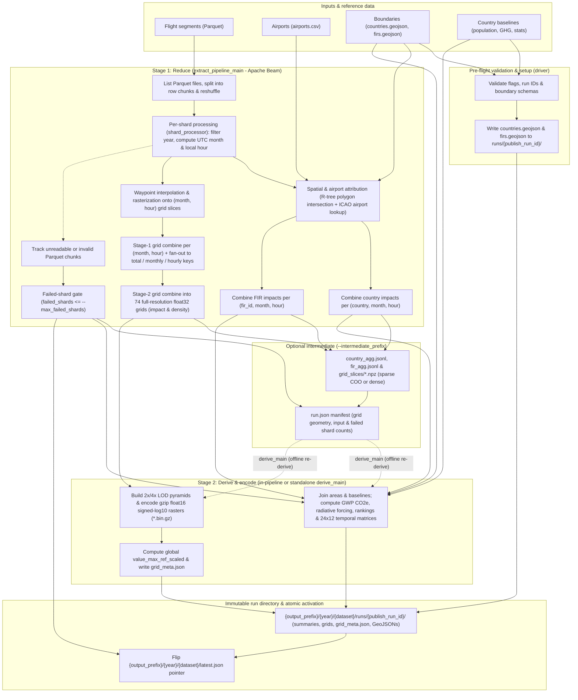

# Regional contrail data extraction

This pipeline turns per-flight-segment contrail energy-forcing (EF) data into
the country, FIR (Flight Information Region) and gridded artifacts that the
regional dashboard serves.

## Overview

The pipeline has two stages. They can run together or separately.

1.  **Reduce** (`extract_pipeline_main`): an Apache Beam pipeline.
    *   Reads flight-segment Parquet files and attributes every segment to
        countries, FIRs and grid cells.
    *   Sums the results into aggregates.
    *   Can also write an *intermediate*: the aggregates plus the raw grid
        slices.
2.  **Derive**: turns the aggregates into metrics (rankings, per-capita and
    per-area values, radiative-forcing equivalents) and encodes the grids.
    *   The reduce binary runs this stage at the end of every run.
    *   `derive_main` runs it alone, without Beam, from a stored intermediate.
        Use it when only metric definitions or encodings changed. It takes
        minutes instead of re-reading all the Parquet input.

Both stages publish into a new, immutable run directory. `latest.json` is
rewritten only after every artifact has been written, so readers never see a
partial run.

### Conceptual stages



1.  **Pre-flight validation & boundary setup**: Before reading segments, the
    driver validates all flags and run IDs, checks that `runs/{publish_run_id}/`
    does not already exist, validates the country and FIR boundary files and
    country baselines, and writes `countries.geojson` and `firs.geojson` into
    the target run directory.
2.  **Shard splitting & per-shard attribution (`shard_processor`)**:
    `extract_pipeline_main` lists matching Parquet files, splits large files
    into row-range chunks (`--max_rows_per_chunk`), and reshuffles them across
    workers. Each worker filters rows to `--input_year`, derives the UTC `month`
    (`YYYYMM`) and local `hour` (`0..23`), intersects segments against country
    and FIR R-tree spatial indexes (plus airport-based country attribution), and
    rasterizes waypoints interpolated along each segment (at most
    `--step_size_meters` apart) onto sparse `(month, hour)` grid slices.
3.  **Parallel reduction & failed-shard gate**: Country and FIR accumulators are
    summed by `(entity, month, hour)`. Grid slices undergo a two-stage combine:
    first per `(month, hour)`, then fanned out to `total`, `monthly`, and
    `hourly` export keys and summed into 74 full-resolution `float32` grids
    (`impact` and `density`). In parallel, unreadable or invalid chunks are
    counted against `--max_failed_shards`.
4.  **Optional intermediate output (`--intermediate_prefix`)**: When configured,
    the reduced country and FIR aggregates (`country_agg.jsonl`,
    `fir_agg.jsonl`) and unencoded `float32` grid slices (`grid_slices/*.npz`)
    are persisted alongside a `run.json` manifest (written only if the
    failed-shard gate passes) so `derive_main` can re-run Stage 2 offline.
5.  **Metric derivation & grid encoding (`derive` / `grid_publish`)**: Country
    and FIR aggregates are joined with polygon areas and country baselines to
    compute CO2e (`gwp20`, `gwp50`, `gwp100`), radiative forcing (`mW/m²`),
    per-capita and per-GHG ratios, rankings, and 24x12 temporal matrices
    (`country_fir_density_df_export_per_country.json`,
    `fir_density_df_export_per_country.json`,
    `country_temporal_density_df_export_per_country.json`,
    `fir_temporal_density_df_export_per_country.json`). Each full-resolution
    grid is downsampled into 2x and 4x LOD pyramids (when >= 3600x1800),
    log-encoded into gzip-compressed `float16` binaries (`*.bin.gz`), and
    summarized in `grid_meta.json` with global `value_max_ref_scaled` scale
    maxima.
6.  **Atomic pointer flip (`latest.json`)**: Only after all summary JSONs,
    `grid_meta.json`, encoded grids, and boundary GeoJSONs are in place—and the
    failed-shard gate has passed—does the pipeline rewrite `latest.json` to
    activate `runs/{publish_run_id}/`.

## Requirements

*   Python 3.11+
*   `apache-beam>=2.71`, `pyarrow>=16`, `pandas`, `numpy`, `shapely>=2`,
    `pyproj`, `pycountry`, `absl-py`

Run every entry point as a module from the repository root (or from any
directory after installing the package with `pip install -e .`):

```sh
python -m data_extraction.extract_pipeline_main --helpfull
```

## Fetching reference data

`fetch_reference_data` downloads and validates the public reference datasets
(`countries.geojson`, `population.csv`, `ghg_emissions.json`, and
`airports.csv`) from their upstream sources into a local directory:

```sh
python -m data_extraction.fetch_reference_data \
  --output_dir=/data/ref \
  --http_timeout_seconds=60.0
```

It normalizes Natural Earth's uppercase `NAME`, `ISO_A2`, and `ISO_A3` feature
properties to lowercase `name`, `iso_a2`, and `iso_a3` in `countries.geojson`
(and validates Shapely geometry and spatial-index construction via
`metadata_loader.load_country_geojson` after writing), fetches up to 100 pages
from the Climate Watch historical GHG emissions endpoint (verifying that
matching `Total excluding LULUCF` / `All GHG` / `Climate Watch` records are
present; filtering happens on load in `metadata_loader`), and validates each
downloaded file. Each upstream URL can be overridden via
`--country_geojson_url`, `--population_csv_url`, `--ghg_emissions_url`, or
`--airports_csv_url` (pass an empty string to skip a file), and per-request HTTP
timeouts are controlled via `--http_timeout_seconds` (default `60.0`).

## Running the reduce pipeline

```sh
python -m data_extraction.extract_pipeline_main \
  --input_year=2024 \
  --dataset=my_dataset \
  --output_prefix=/data/out \
  --segments_path='/data/segments/2024/*.parquet' \
  --airports_path=/data/ref/airports.csv \
  --firs_path=/data/ref/firs.geojson \
  --country_geojson_path=/data/ref/countries.geojson \
  --population_path=/data/ref/population.csv \
  --ghg_emissions_path=/data/ref/ghg_emissions.json \
  --grid_width=3600 --grid_height=1800 \
  --min_lon=-180 --max_lon=180 --min_lat=-90 --max_lat=90 \
  --step_size_meters=10000 \
  -- --runner=DirectRunner
```

Beam pipeline options, such as `--runner`, project, region and worker settings,
must come **after a bare `--`**. The pipeline's own flags are parsed with
`absl`, which rejects flags it doesn't recognise. Everything after `--` goes
to `PipelineOptions` unchanged. Without a runner option, Beam uses the
`DirectRunner`.

All paths go through the shared filesystem layer (`common/fs.py`), which handles
local paths directly, lazily delegates remote URIs (`gs://`, `s3://`, `hdfs://`)
to `apache_beam.io.filesystems.FileSystems` when `apache-beam` is installed, and
supports custom backends registered with `fs.register_filesystem_backend`.

### Required flags

The pipeline checks every flag in this table, and lists `--segments_path`,
before it loads any reference data or segments. A missing or invalid value, or a
`--segments_path` that matches no Parquet files, raises `ValueError`
immediately. Before launching the Beam pipeline, the driver also loads and
validates the boundary GeoJSONs (`--firs_path`, `--country_geojson_path`) and
country baseline files, raising `ValueError` (if FIR feature validation or
`--expected_fir_count` fails, or a country feature lacks `iso_a2` or `name`) or
`RuntimeError` (if a boundary index or baseline file is missing, unreadable, or
empty). `--airports_path` is only loaded by the worker processes (via
`shard_processor.load_process_worker_context`), after the run directory has
been created and the boundary GeoJSONs written to it, so a bad airports path
fails the run late and the next attempt needs a new `--publish_run_id`.

| Flag | Description |
| --- | --- |
| `--input_year` | Four-digit calendar year of the input. Becomes a path component. Rows outside this year are dropped. |
| `--dataset` | Dataset name, used as a path component. Up to 64 letters, digits, `-` or `_`. Start the server with `CONTRAILS_DATASET` set to the same value. |
| `--output_prefix` | Root directory that artifacts are published under. |
| `--segments_path` | Glob, directory or single file of segment Parquet files. A directory is listed non-recursively and only `.pq` / `.parquet` files are kept. Must match at least one file. |
| `--airports_path` | [OurAirports](https://ourairports.com/data/) `airports.csv`, used to map departure and arrival airports to countries. |
| `--firs_path` | FIR/UIR boundary GeoJSON. See [FIR GeoJSON](#fir-geojson). |
| `--country_geojson_path` | Country boundary GeoJSON with `iso_a2` and `name` properties, for example Natural Earth admin-0. |
| `--grid_width`, `--grid_height` | Output grid size in pixels (1..32767). Grids >= 3600x1800 generate LOD pyramids and must be divisible by 4. |
| `--min_lon`, `--max_lon`, `--min_lat`, `--max_lat` | Output grid extent in degrees (min < max, within [-180, 180] and [-90, 90]). |
| `--step_size_meters` | Maximum spacing between the waypoints used to rasterise each segment onto the grid (must be > 0). Segments also get at least two waypoints per grid cell they span. |
| **At least one of** `--population_path`, `--ghg_emissions_path`, `--country_stats_path` | Country baseline data used for per-capita and per-emissions metrics. See [Country baselines](#country-baselines). |

### Optional flags

| Flag | Default | Description |
| --- | --- | --- |
| `--expected_fir_count` | `0` | If positive, `--firs_path` must contain exactly this many FIRs. `0` skips the check. |
| `--max_rows_per_chunk` | `1000000` | Splits large Parquet files into chunks of at most this many rows, for parallelism. `0` disables splitting. |
| `--max_failed_shards` | `0` | Number of input chunks that may fail (unreadable, missing or unsupported columns, malformed chunk descriptors, or caught processing errors) before the run fails. Any negative value disables the check. See [Failure handling](#failure-handling). |
| `--intermediate_prefix` | empty | If set, also writes the intermediate that `derive_main` needs. Empty disables it. |
| `--run_id` | fresh UTC-stamped id | Identifier for this run. See [Run ids](#run-ids). |
| `--publish_run_id` | `--run_id` | Name of the published run directory. Must not exist yet. |

### Run ids

A run id is 1 to 128 ASCII letters, digits, `.`, `-` or `_`, other than `.` and
`..`. Both binaries check `--run_id` and `--publish_run_id` before reading any
input.

Published runs are never overwritten. If
`{output_prefix}/{year}/{dataset}/runs/{publish_run_id}/` already exists, the
run fails before writing anything, even if that run is the one `latest.json`
names. To re-run, pass a new id or leave the flag empty to get a fresh one.

## Re-deriving from an intermediate

```sh
python -m data_extraction.derive_main \
  --intermediate_prefix=/data/intermediate \
  --run_id=<run id written by the reduce run> \
  --input_year=2024 \
  --dataset=my_dataset \
  --output_prefix=/data/out \
  --firs_path=/data/ref/firs.geojson \
  --country_geojson_path=/data/ref/countries.geojson \
  --population_path=/data/ref/population.csv
```

The grid geometry comes from the intermediate's manifest, not from flags. This
way the slices are always encoded at the resolution they were rasterised at.

Before it publishes anything, `derive_main` checks that the manifest and all
grid slices are present, and that the run lost no more shards than
`--max_failed_shards` allows. If any check fails, it exits without publishing
and leaves `latest.json` unchanged.

### Required flags

As for reduce, every flag in this table is checked before any input is read, and
a missing or invalid value raises `ValueError`.

| Flag | Description |
| --- | --- |
| `--intermediate_prefix` | Root the reduce run wrote its intermediate to. |
| `--run_id` | Intermediate run to read. |
| `--input_year`, `--dataset` | Must match the reduce run. |
| `--output_prefix` | Root directory to publish under. |
| `--firs_path`, `--country_geojson_path` | Boundary files, as for reduce. You can pass different files from the reduce run: `area_sq_km` and area-based metrics change while aggregates already attributed to countries and FIRs don't, any attributed country absent from the replacement `--country_geojson_path` (`area_sq_km == 0.0`) also has its territorial per-capita and vs-national-GHG metrics nulled out, and the published `countries.geojson` / `firs.geojson` are the new files (including any added polygons that have no rows in `*_export_per_country.json`) rather than the attribution geometry. The intermediate does not record which boundary files reduce used. |
| **At least one of** `--population_path`, `--ghg_emissions_path`, `--country_stats_path` | Country baselines, as for reduce. |

### Optional flags

| Flag | Default | Description |
| --- | --- | --- |
| `--expected_fir_count` | `0` | As for reduce. |
| `--max_failed_shards` | `0` | Number of failed shards the manifest may record. Any negative value disables the check. See [Failure handling](#failure-handling). |
| `--publish_run_id` | fresh id | Published run directory. The default is a new id, so a re-derivation never overwrites the run it read from. An existing run is refused; see [Run ids](#run-ids). |

## Input formats

### Flight segments (Parquet)

Each row is one flight segment. Column names are matched case-insensitively.
For each field, the first matching candidate below is used.

| Field | Required | Accepted column names |
| --- | --- | --- |
| Start longitude / latitude | yes | `lon_start`, `longitude_start`, `start_lon` / `lat_start`, `latitude_start`, `start_lat` |
| End longitude / latitude | yes | `lon_end`, `longitude_end`, `end_lon` / `lat_end`, `latitude_end`, `end_lat` |
| Start time | yes | `time_start`, `timestamp_start`, `time`, `flight_time`. Must be a PyArrow timestamp, date, or ISO-8601 string; raw integer or float epoch columns are rejected. |
| Energy forcing (MJ) | yes | `sum_ef_mj`, `ef_mj`, `contrail_ef_mj`, `energy_forcing_mj`. Must be **non-effective** (RF-based) energy forcing; see [Energy forcing input contract](#energy-forcing-input-contract). Null and non-finite values are read as 0. |
| UTC offset (hours) | no | `time_start_tz`, `tz`, `timezone_offset`. Numeric or numeric-string hours (e.g. `"+02"`, `"-05"`) within [-14, 14]; non-numeric strings (e.g. `"+05:30"`, `"UTC"`) and out-of-range values are dropped as invalid rows. A null value is treated as UTC. |
| Departure airport (ICAO) | no | `departure_airport_icao`, `departure_airport`, `dep_icao`, `origin_airport` |
| Arrival airport (ICAO) | no | `arrival_airport_icao`, `arrival_airport`, `arr_icao`, `destination_airport` |

A chunk counts as a failed shard if it cannot be opened as Parquet, is missing
a required column, has a time column that is not a timestamp, date or string
(for example raw integer/float epochs) or a timezone column that is neither
numeric nor string, or raises an I/O, Arrow, type or value error during
processing. Any other exception fails the pipeline. Individual rows with an
unparsable or out-of-range timezone value (such as `"+05:30"`) are dropped and
counted in the `invalid_timestamps_dropped` counter; they do not count against
`--max_failed_shards`.

#### Energy forcing input contract

The energy forcing column must hold **non-effective** contrail energy forcing:
the radiative forcing (RF) of each segment's contrail integrated over its area
and lifetime, with no effective radiative forcing to radiative forcing ratio
($\text{ERF/RF}$) applied. CoCiP outputs such as the contrails.org per-segment
export are in this form.

The pipeline applies $\text{ERF/RF} = 0.42$ itself, and only when converting
energy forcing to $\text{CO}_2\text{e}$ (it is folded into the
`GWP*_TONNES_PER_MJ` multipliers, see section 1 of
[Scientific methodology & metric derivations](#scientific-methodology--metric-derivations)).
The only non-effective published outputs are `mean_rf_mw_per_sq_m` (and its FIR
scope variants), `impact_density_sq_km`, and the raw values of the impact grids.
Every $\text{CO}_2\text{e}$ value includes $\text{ERF/RF}$, including the
temporal matrices and the dashboard's $\text{CO}_2\text{e}$ grid view (which
converts the raw grids with `gwp_tonnes_co2e_per_mj` from `grid_meta.json`).

If your source already applies $\text{ERF/RF}$ (effective energy forcing),
divide it by 0.42 before running the pipeline. Otherwise the ratio is applied
twice and every $\text{CO}_2\text{e}$ value is too low by a factor of
$0.42$ (−58%), while the radiative forcing metrics silently report effective
forcing.

### Airports (CSV)

The [OurAirports](https://ourairports.com/data/) `airports.csv` format
(`https://davidmegginson.github.io/ourairports-data/airports.csv`, Public
Domain). The airport code is taken from `gps_code`, `ident` or `iata_code`, and
the country from `iso_country`.

### FIR GeoJSON

A FeatureCollection with one Polygon or MultiPolygon feature per FIR/UIR. Each
feature must carry these properties:

| Property | Required | Content |
| --- | --- | --- |
| `fir_icao` | yes | ICAO location indicator, e.g. `EDGG`. Upper-cased on load. |
| `firname` | yes | FIR name. Upper-cased, with `FIR` / `UIR` prefixes and suffixes stripped, on load. |
| `fir_to_country_iso2s` | yes | ISO 3166-1 alpha-2 code(s) of the controlling country, comma-separated if several, e.g. `SN, ML`. |
| `type` | yes | `domestic` or `international` (case-insensitive). |
| `areasqkm` | no | Area in km². If absent, it is computed from the geometry. |

No other property names are read, and nothing is inferred: there is no mapping
file, no built-in country table and no guess from the name. `fir_id` is derived
from `fir_icao` and `firname` and must be unique. A feature with a missing or
invalid property fails validation before any segments are read.

FIR boundary data is not distributed with this repository and
`fetch_reference_data` does not download it; supply any FIR GeoJSON in this
format. `testdata/global_firs.geojson` is a small synthetic example.
`preprocess_icao_fir_2015.py` converts the ICAO 2015 FIR shapefile release
(`ICAO_FIR_2015.zip`, containing `ICAOFIRFULallDensify.shp` and
`ICAOFIRFULallDensify.dbf`; unzip it first) into this canonical GeoJSON
format. It parses ESRI
`.shp` and `.dbf` binary records directly using Python's standard `struct`
module and `shapely` (no external GDAL or `pyshp` installation required), merges
fragments sharing `(fir_icao, firname)`, and attaches the ICAO-2015-specific
country and domestic/international mappings:

```sh
python -m data_extraction.preprocess_icao_fir_2015 <in.shp> <in.dbf> <out.geojson>
```

### Country GeoJSON

A FeatureCollection with `iso_a2` and `name` (and optional `iso_a3`) properties
on each feature, sourced from [Natural Earth](https://www.naturalearthdata.com/)
1:110m Cultural Vectors — Admin 0 Countries
(`https://raw.githubusercontent.com/nvkelso/natural-earth-vector/master/geojson/ne_110m_admin_0_countries.geojson`,
Public Domain).

Upstream Natural Earth files store these fields under uppercase `NAME`,
`ISO_A2`, and `ISO_A3` keys. `metadata_loader.load_country_geojson` normalizes
uppercase `NAME`, `ISO_A2`, and `ISO_A3` properties to lowercase `name`,
`iso_a2`, and `iso_a3` on load, and `fetch_reference_data` strips unused Natural
Earth attributes when writing `countries.geojson`. The loaded features are
published as `countries.geojson` in the run directory.

### Country baselines

The three sources are applied in this order. Later sources override earlier
ones, field by field. Both `--population_path` and `--ghg_emissions_path` are
keyed by ISO 3166-1 alpha-3 (`iso_a3`) and joined to ISO 3166-1 alpha-2 via
`pycountry` (`databases/iso3166-1.json`).

| Flag | Source & Format |
| :--- | :--- |
| `--population_path` | [DataHub `datasets/population`](https://github.com/datasets/population) CSV (`https://raw.githubusercontent.com/datasets/population/main/data/population.csv`, derived from World Bank World Development Indicators `SP.POP.TOTL`). Columns: `Country Name`, `Country Code` (ISO 3166-1 alpha-3), `Year`, `Value`. The latest year ≤ `--input_year` is used. |
| `--ghg_emissions_path` | [Climate Watch](https://www.climatewatchdata.org/) historical-emissions REST API JSON (`https://www.climatewatchdata.org/api/v1/data/historical_emissions?source_ids[]=274&gas_ids[]=553&sector_ids[]=3208&per_page=500`), in Mt CO2e. Filters records to `data_source == "Climate Watch"` (`274`), `gas == "All GHG"` (`553`), and `sector == "Total excluding LULUCF"` (`3208`), keyed by `iso_code3`. The latest year ≤ `--input_year` is used. |
| `--country_stats_path` | JSON `{"<ISO2>": {"population": <number>, "ghg_mtco2e": <number>}}`. Use it for codes outside ISO 3166-1 (for example `XK`) or to correct individual values. |

## Scientific methodology & metric derivations

All physical conversion constants and canonical field templates are defined in
`common/constants.py` and implemented in `data_extraction/metric_derivations.py`
and `data_extraction/grid_publish.py`.

### 1. Contrail energy forcing to $\text{CO}_2\text{e}$ (`GWP20`, `GWP50`, `GWP100`)

Per-segment contrail energy forcing ($\text{EF}$, in megajoules $\text{MJ}$) is
converted into metric tonnes of $\text{CO}_2$-equivalent
($\text{tCO}_2\text{e}$) with one fixed multiplier per time horizon $H$. The
multiplier spreads the energy over Earth's surface area ($A_{\text{Earth}} =
5.10064472 \times 10^{14}\text{ m}^2$) and one year ($\tau_{\text{yr}} = 3.1536
\times 10^{7}\text{ s}$), divides by the Absolute Global Warming Potential of
$\text{CO}_2$ over that horizon ($\text{AGWP}_{\text{CO}_2}(H)$, from Joos et
al., 2013, *Atmos. Chem. Phys.*, 13, 2793–2825, and IPCC AR5 WG1 Chapter 8,
Myhre et al., 2013), and scales by the contrail effective radiative forcing to
radiative forcing efficacy factor $\varepsilon = 0.42$ (Lee et al., 2021,
*Atmospheric Environment*, 244, 117834; Teoh et al., 2024, *Atmos. Chem. Phys.*,
24, 725–748):

$$
\frac{\text{tCO}_2\text{e}}{\text{MJ}} =
\frac{\varepsilon \cdot 10^{6}\text{ J/MJ}}
{A_{\text{Earth}} \cdot \text{AGWP}_{\text{CO}_2}(H) \cdot \tau_{\text{yr}}
\cdot 10^{3}\text{ kg/t}}
$$

| Horizon | Constant (`common/constants.py`) | Multiplier ($\text{tCO}_2\text{e / MJ}$) | $\text{AGWP}_{\text{CO}_2}(H)$ ($\text{W m}^{-2}\text{ yr kg}^{-1}$) |
| --- | --- | --- | --- |
| 20-year (`gwp20`) | `GWP20_TONNES_PER_MJ` | `1.048618e-6` | $2.49 \times 10^{-14}$ |
| 50-year (`gwp50`) | `GWP50_TONNES_PER_MJ` | `0.4945187e-6` | $5.28 \times 10^{-14}$ |
| 100-year (`gwp100`) | `GWP100_TONNES_PER_MJ` | `0.2847392e-6` | $9.17 \times 10^{-14}$ |

The multipliers are fixed constants; the formula above documents how they relate
to the $\text{AGWP}_{\text{CO}_2}(H)$ and efficacy values. At GWP100, one tonne
of $\text{CO}_2\text{e}$ corresponds to about $3.51 \times 10^{12}\text{ J}$ of
contrail energy forcing.

The multipliers expect non-effective energy forcing input (see
[Energy forcing input contract](#energy-forcing-input-contract)): $\varepsilon$
is the only place the pipeline applies $\text{ERF/RF}$. Other tools that use
slightly different constants (for example $A_{\text{Earth}} = 5.101 \times
10^{14}\text{ m}^2$ and $\text{AGWP}_{\text{CO}_2}(50) = 5.30 \times
10^{-14}$) give $\text{CO}_2\text{e}$ values that differ by less than 0.4%.

### 2. Spatial vs. departure-airport attribution

Each flight segment is attributed in two complementary ways during Stage 1
(`shard_processor.py`):

*   **Spatial (territorial / airspace) attribution (`co2e_*`, `fir_total_*`,
    `fir_dom_*`, `fir_int_*`)**: The segment line string is intersected against
    country polygons (`countries.geojson`) and FIR polygons (`firs.geojson`)
    using a Shapely STRtree spatial index. A polygon covering fraction $f \in
    [0, 1]$ of the segment receives $f \cdot \text{EF}_{\text{MJ}}$ (accumulated
    as `prop_sum_ef_mj` in Stage 1 `country_agg.jsonl` and `fir_agg.jsonl` to
    derive the published `co2e_*` and `mean_rf_mw_per_sq_m` metrics) and $f
    \cdot L_{\text{km}}$ (`total_flight_distance_km`, plus
    `contrail_flight_distance_km` when $\text{EF}_{\text{MJ}} \ne 0$). For each
    country, FIRs listing that country's ISO2 code in `fir_to_country_iso2s` are
    also rolled up by scope (`fir_dom_*` for domestic FIRs, `fir_int_*` for
    international/oceanic FIRs, and `fir_total_*` across both).
*   **Departure-airport attribution (`outgoing_flight_*`)**: For every
    contrail-forming segment with a known departure airport, the entire
    segment's energy forcing is attributed to the country of its departure
    airport (`outgoing_flight_impact`, with `departure_airport_icao` mapped to
    `iso_country` via OurAirports `airports.csv`), measuring the downstream
    contrail footprint of traffic departing from a country regardless of which
    airspace the contrail forms in.

### 3. Radiative forcing equivalent ($\text{mW/m}^2$)

For a country or FIR with geodesic area $A_{\text{km}^2}$ (`area_sq_km`) and
observed calendar days $D$ (`days_covered`, summed across distinct observed
months in the dataset, where a partly observed month counts in full, or
`365`/`366` for the full calendar year when no months are observed, in which
case `months_covered` is 0), accumulated energy forcing $\text{EF}_{\text{MJ}}$
is converted to mean radiative forcing density in milliwatts per square meter
(`mean_rf_mw_per_sq_m`, and `{scope}_mean_rf_mw_per_sq_m` for country FIR
scopes):

$$
\text{RF}_{\text{mW/m}^2} =
\frac{\text{EF}_{\text{MJ}}}{A_{\text{km}^2} \times D \times 86.4}
$$

Because $1\text{ MJ} = 10^6\text{ J}$, $1\text{ km}^2 = 10^6\text{ m}^2$, and
$1\text{ day} = 86{,}400\text{ s}$, dividing $\text{MJ / km}^2\text{ / day}$ by
$86.4$ yields $\text{mW/m}^2$ ($10^{-3}\text{ W/m}^2$).

### 4. Per-capita & national GHG comparisons

When country baseline data (`population` and `ghg_mtco2e`) are available for a
country, the following fields are computed across territorial (`co2e_{gwp}_*`),
departure-airport (`outgoing_flight_co2e_{gwp}_*`), and controlled-FIR
(`{scope}_co2e_{gwp}_*`) scopes:

*   `co2e_{gwp}_tonnes_per_capita` $= \text{co2e\_\{gwp\}\_tonnes} /
    \text{population}$ (null unless `population > 0` and, for territorial
    `co2e_{gwp}_*` only, `area_sq_km > 0`; departure-airport and controlled-FIR
    scopes do not check area, so an empty FIR scope with `{scope}_area_sq_km ==
    0.0` produces `0.0` when `population > 0`).
*   `co2e_{gwp}_per_capita_vs_world_avg` $=
    \text{co2e\_\{gwp\}\_tonnes\_per\_capita} / (6.00328575 \times f)$ (unscaled
    ratio), where `WORLD_AVG_GHG_PER_CAPITA_TONNES = 6.00328575`
    $\text{tCO}_2\text{e/capita/yr}$ (null when the per-capita value is null).
*   `co2e_{gwp}_vs_national_ghg` $= \text{co2e\_\{gwp\}\_tonnes} /
    (\text{ghg\_mtco2e} \times 10^6 \times f)$ (unscaled ratio; null unless
    `ghg_mtco2e > 0` and, for territorial `co2e_{gwp}_*` only, `area_sq_km > 0`;
    an empty FIR scope with `{scope}_area_sq_km == 0.0` produces `0.0` when
    `ghg_mtco2e > 0`).
*   $f = D / D_{\text{year}}$ is the observed share of the year ($D$ =
    `days_covered`, $D_{\text{year}}$ = 365 or 366). $\text{CO}_2\text{e}$
    totals cover only the observed days while both baselines are annual, so the
    baselines are scaled to the same period; $f = 1$ for a full year. Two
    caveats apply to partial-year datasets: $D$ counts every observed month in
    full (see section 3), so a dataset that ends mid-month overstates $f$ and
    understates the ratios; and the ratios compare the observed period with the
    same share of annual emissions, assuming emissions are spread evenly over
    the year. They are period ratios, not annualized estimates: contrail impact
    is strongly seasonal, so a few months of data do not represent a full year.
*   `co2e_tonnes_share` (and its `outgoing_flight_` and `{scope}_` variants) is
    the entity's fraction of the dataset total energy forcing: country EF over
    the summed EF of all countries, outgoing EF over the global outgoing EF, and
    FIR or FIR-scope EF over the summed EF of all FIRs. It is identical for
    every GWP horizon, signed (net cooling yields a negative share), unranked,
    and `None` when the total is zero. Country `fir_total_` shares can sum to
    more than 1 because a multinational FIR counts for each controlling country.
*   Rank fields (`*_rank`) are unique 1-indexed descending ranks across all
    entities with finite metric values (`None` when a metric is missing), with
    ties broken deterministically by `(iso_a2, name)` for countries and `fir_id`
    for FIRs. Impact densities (`impact_density_sq_km` and
    `{scope}_impact_density_sq_km`) are not ranked: they equal mean RF times the
    dataset-wide observation window, so their rank is `mean_rf_mw_per_sq_m_rank`
    (or `{scope}_mean_rf_mw_per_sq_m_rank`).

### 5. Grid rasterization & `signed_log10_ref_scaled` float16 encoding

During Stage 1 (`grid_rasterizer.py`), any segment with
$|\text{lon}_{\text{end}} - \text{lon}_{\text{start}}| > 180^\circ$ is first
split at $\pm 180^\circ$ into western and eastern sub-segments
(`_split_antimeridian_grid_segments`), apportioning both `ef` and its initial
density weight of $1.0$ by the longitude span fraction on each side
(`geo_utils.antimeridian_crossing_fraction`). Each resulting sub-segment of
haversine length $L$ is then split into $N = \max(\lceil L /
\text{step\_size\_meters} \rceil, \lceil 2 \times \text{cells spanned} \rceil,
1)$ equal sub-intervals, where $\text{cells spanned} =
\max(|\text{lon}_{\text{end}} - \text{lon}_{\text{start}}| / \Delta\text{lon}, \
|\text{lat}_{\text{end}} - \text{lat}_{\text{start}}| / \Delta\text{lat})$
(`_count_waypoints_per_segment`), and one waypoint is placed at the midpoint of
each sub-interval by linear interpolation in longitude and latitude.
`--step_size_meters` is therefore an upper bound on the waypoint spacing. Each
sub-segment's apportioned energy forcing and density weight are split evenly
over its $N$ waypoints (`1/N` per waypoint), any waypoints outside the
configured `[min_lon, max_lon] × [min_lat, max_lat]` bounds are dropped without
renormalizing the remaining waypoints (`_waypoint_bbox_mask`), and the in-bounds
waypoints are accumulated into `(month, hour)` float32 rasters for two grid
families: `impact` ($\text{MJ}$ per cell) and `density` (number of flight
segments per cell). The density grid counts every valid segment, including
segments with zero energy forcing, and long and short segments weigh the same
($1.0$ in total across their waypoints before bounding-box filtering). Stage 1
fans these out into 74 export keys per run: 1 total grid, 12 monthly grids (UTC
month of year) and 24 hourly grids (local hour) for both `impact` and `density`.
See [Output layout](#output-layout) for the file names.

During Stage 2 (`grid_publish.py`), grids with resolution $\ge 3600 \times 1800$
are downsampled by $4\times$ (`_lod0`) and $2\times$ (`_lod1`) via
block-summing (preserving the total $\text{MJ}$ and segment weight). Their
dimensions must be divisible by 4; otherwise the run fails. Before encoding,
each cell value $v$ on a grid of dimensions $(W, H)$ is scaled by the ratio of
its pixel count to a reference $1200 \times 600$ grid (`REF_PIXELS = 1200.0 *
600.0` in `grid_rasterizer.py`; for the global extent this is a $0.3^\circ$
cell):

$$v_{\text{ref}} = v \times \frac{W \times H}{1200 \times 600}$$

so that a uniform physical density produces the same encoded value across all
LOD levels. Each cell is then transformed with a signed base-10 logarithm and
serialized as IEEE-754 `float16` in native byte order (little-endian on x86
and ARM; row-major from `min_lat`/`min_lon` to `max_lat`/`max_lon`), then
compressed with `gzip`:

$$
\text{enc}(v) = \operatorname{sign}(v_{\text{ref}}) \cdot
\log_{10}\!\left(1 + |v_{\text{ref}}|\right)
$$

To decode a `float16` cell $y$ back to reference-scaled units on the client:
$v_{\text{ref}} = \operatorname{sign}(y) \cdot (10^{|y|} - 1)$.

## Output layout

```
{output_prefix}/{year}/{dataset}/
├── latest.json                                              # names the current run; rewritten last
└── runs/{publish_run_id}/
    ├── country_fir_density_df_export_per_country.json       # per-country annual summary & rankings
    ├── fir_density_df_export_per_country.json               # per-FIR annual summary & rankings
    ├── country_temporal_density_df_export_per_country.json  # per-country 24x12 temporal matrices
    ├── fir_temporal_density_df_export_per_country.json      # per-FIR 24x12 temporal matrices
    ├── grid_meta.json                                       # geometry, LODs, encoding, scale maxima
    ├── {grid_prefix}[_lod0|_lod1].bin.gz                    # 74 grid keys + LOD variants (see below)
    ├── countries.geojson                                    # boundaries this run was derived with
    └── firs.geojson
```

`{grid_prefix}` is one of the following, where `{kind}` is `impact` or
`density`:

*   `total_global_{kind}_grid`: the whole year.
*   `monthly_global_{kind}_grid_{MM}`: one grid per UTC month of year, `01` to
    `12`.
*   `hourly_global_{kind}_grid_{HH}`: one grid per local hour of day, `00` to
    `23`.

The file without a suffix is full resolution; `_lod1` is downsampled $2\times$
and `_lod0` $4\times$ (only for grids of at least $3600 \times 1800$).

### Published JSON artifact schemas

*   `latest.json`: `{"schema_version": 1, "run_id": "<publish_run_id>",
    "published_at": "<ISO-8601 UTC>"}`.
*   `country_fir_density_df_export_per_country.json`: JSON array of country
    objects identified by `iso_a2` and `name` (`iso_a2` alone is not unique for
    unofficial codes such as `-99`), plus `iso_a3`, `area_sq_km`,
    `population`, `ghg_mtco2e`, `months_covered`, and `days_covered`,
    containing territorial metrics (`total_flight_distance_km`,
    `contrail_flight_distance_km`, `segment_count`, `contrail_segment_count`,
    `total_flight_impact`, `local_flight_impact`, `in_country_impact`,
    `over_region_vs_outgoing_impact`, `impact_density_sq_km`,
    `mean_rf_mw_per_sq_m`, `co2e_tonnes_share`, `co2e_{gwp}_tonnes`,
    `co2e_{gwp}_tonnes_sq_km`, `co2e_{gwp}_tonnes_per_capita`,
    `co2e_{gwp}_per_capita_vs_world_avg`, `co2e_{gwp}_vs_national_ghg`, and
    `*_rank` fields), departure-airport metrics (`outgoing_flight_impact`,
    `outgoing_flight_co2e_tonnes_share`, `outgoing_flight_co2e_{gwp}_*`, and
    `*_rank` fields), and aggregated controlled-FIR scopes (`fir_total_*`,
    `fir_dom_*`, `fir_int_*`: `{scope}_area_sq_km`, `{scope}_segment_count`,
    `{scope}_contrail_segment_count`, `{scope}_flight_distance_km`,
    `{scope}_contrail_flight_distance_km`, `{scope}_fir_id`, `{scope}_firname`,
    `{scope}_fir_icao`, `{scope}_impact_density_sq_km`,
    `{scope}_mean_rf_mw_per_sq_m`, `{scope}_co2e_tonnes_share`,
    `{scope}_co2e_{gwp}_*`, and `{scope}_*_rank`). Notes:
    *   The whole `fir_total_*` / `fir_dom_*` / `fir_int_*` block is absent from
        rows of countries that control no FIR. A country that controls FIRs has
        all three scopes; for an empty sub-scope (`fir_int` or `fir_dom` with
        `{scope}_area_sq_km == 0.0` and empty `{scope}_fir_*` lists), the
        per-area fields (`{scope}_impact_density_sq_km`,
        `{scope}_mean_rf_mw_per_sq_m`, `{scope}_co2e_{gwp}_tonnes_sq_km`) are
        `null`, while `{scope}_co2e_{gwp}_tonnes_per_capita`,
        `{scope}_co2e_{gwp}_per_capita_vs_world_avg`, and
        `{scope}_co2e_{gwp}_vs_national_ghg` are `0.0` (when `population > 0` /
        `ghg_mtco2e > 0`) and receive numeric ranks.
    *   `{scope}_fir_id`, `{scope}_firname` and `{scope}_fir_icao` are
        index-aligned lists with one entry per FIR, sorted by `fir_id`.
    *   Unknown baselines are published as `population` 0, `ghg_mtco2e` 0.0
        and `iso_a3` `""`, and a country without a boundary polygon has
        `area_sq_km` 0.0. Metrics that need the missing value are null.
*   `fir_density_df_export_per_country.json`: JSON array of FIR objects keyed by
    `fir_id`, `fir_icao`, `firname`, `type` (`"domestic"` or `"international"`),
    `fir_to_country_iso2s` (list of ISO2 codes, primary controlling country
    first; sorted, with no primary, if input features for the same `fir_id`
    disagree), and `area_sq_km` (plus `months_covered` and `days_covered`), with
    FIR contrail metrics (`total_flight_distance_km`,
    `contrail_flight_distance_km`, `segment_count`, `contrail_segment_count`,
    `impact_density_sq_km`, `mean_rf_mw_per_sq_m`, `co2e_tonnes_share`,
    `co2e_{gwp}_tonnes`, `co2e_{gwp}_tonnes_sq_km`) and 1-indexed `*_rank`
    fields (`co2e_{gwp}_tonnes_rank` and
    `mean_rf_mw_per_sq_m_rank`).
*   `country_temporal_density_df_export_per_country.json`: Top-level JSON array
    of `TemporalBundleRow` objects—one per country entity (`iso_a2`, `name`)
    with attributed segments. There is no aggregate or global row, and
    countries that only appear through the FIRs they control have an annual row
    but no temporal bundle. Each bundle contains 24 × 12
    (`[local_hour][month_index]` for local hours `0..23` and UTC months `0..11`,
    0 = January) matrices
    for `co2e_gwp20_tonnes`, `co2e_gwp50_tonnes`, `co2e_gwp100_tonnes`,
    `segment_count`, `contrail_segment_count`, `total_flight_distance_km`, and
    `contrail_flight_distance_km`. Country $\text{CO}_2\text{e}$ matrices are
    territorial (over-region) only; departure-airport impact has no temporal
    breakdown.
*   `fir_temporal_density_df_export_per_country.json`: Top-level JSON array of
    `TemporalBundleRow` objects—one per FIR (`fir_id`, `firname`, `fir_icao`,
    `fir_to_country_iso2s`, `type`), containing the same 24 × 12 hour × month
    matrix fields as the country temporal bundles.
*   `grid_meta.json`: Written once after every grid is encoded. Besides
    `grid_name` (`"global_grid"`), full dimensions (`width`, `height`), the
    shared bounding box (`min_lon`, `max_lon`, `min_lat`, `max_lat`, `lon_step`,
    `lat_step`, and nested `bbox`), `dtype` (`"float16"`), `encoding`
    (`"signed_log10_ref_scaled"`), `compression` (`"gzip"`), full-resolution
    `lod` (`2`), `origin` (`"lower_left"`), and the `lods` dictionary keyed by
    LOD level string (`"2"`, and `"1"` / `"0"` when LOD pyramids are generated;
    each entry holds `width`, `height`, `lon_step`, `lat_step` and `lod`), it
    holds:
    *   `gwp_tonnes_co2e_per_mj`: `{"gwp20": 1.048618e-6, "gwp50": 4.945187e-7,
        "gwp100": 2.847392e-7}`.
    *   `value_max_ref_scaled`: `{"density": …, "impact": …}`, the largest
        absolute cell value of each grid type over all its buckets (total,
        monthly and hourly), in the reference-scaled units the grids are
        log-encoded in (cell value × width × height / (1200 × 600)). The UI uses
        it as the top of the colour scale and has no fallback: grids from a run
        without it are not drawn.
*   `countries.geojson` and `firs.geojson`: Normalized GeoJSON
    `FeatureCollection` files published with the run (`name`, `iso_a2`, and
    `iso_a3` properties on country features; `fir_id`, `fir_icao`, `firname`,
    `fir_to_country_iso2s`, and `type` properties on FIR features; any
    additional properties on the input features, such as `areasqkm`, are
    preserved in place).

The intermediate, if enabled, is written to
`{intermediate_prefix}/{year}/{dataset}/runs/{run_id}/`. It holds:

*   a manifest with the grid geometry, input file count, failed shard count and
    version, written after the aggregates;
*   the country and FIR aggregates as JSON Lines;
*   `grid_slices/{prefix}.npz`: one `.npz` slice per grid artifact prefix
    (stored as sparse COO arrays when at most 25% of cells are non-zero, or as a
    dense float32 array otherwise).

## Failure handling

*   **Missing inputs:** a required flag that is missing, or a `--segments_path`
    that matches no files, raises `ValueError` before any reference data or
    segments are read. A run with no input would otherwise publish zeros over
    the live dataset.
*   **Failed shards:** Parquet chunks that fail (see
    [Flight segments](#flight-segments-parquet)) are logged and counted. If
    the count exceeds `--max_failed_shards`, `latest.json` is not
    updated and the run fails. The run directory may be partly written, but
    nothing points to it. The intermediate manifest is not written either, so
    `derive_main` cannot republish the run.
*   **Lossy intermediates:** the manifest records how many shards failed.
    `derive_main` refuses to publish a run with no manifest, or one whose count
    exceeds its own `--max_failed_shards` (default `0`). To republish a run that
    reduce accepted with a budget, pass the same budget to `derive_main`.
*   **Boundary integrity:** the FIR and country files are validated before any
    segments are processed. The checks cover unique IDs, the expected count
    and a non-empty spatial index.

## Known limitations

*   **Timezones:** Fractional numeric UTC offsets such as +5.5 (+5:30) or +5.75
    (+5:45) are rounded to the nearest whole hour (via `np.round`, which rounds
    halves to even: +4.5 becomes 4 and +5.5 becomes 6), so local-time
    breakdowns for those zones are shifted by up to 30 minutes.
*   **Local hour vs. UTC month and year:** `month` (`YYYYMM`) and `year` buckets
    are derived from the UTC timestamp, ensuring consistent alignment with
    global annual reference datasets (e.g. Climate Watch GHG emissions and World
    Bank populations) and preventing boundary flight drops when input Parquet
    files are partitioned by UTC calendar year. The `hour` bucket is shifted by
    the timezone offset modulo 24 (`(utc_hour + tz_offset) % 24`) to represent
    local solar/wall-clock hours for diurnal cycle analysis. Consequently,
    flights near midnight on month boundaries are bucketed under their UTC month
    with their local hour (for instance, 23:30 UTC on June 30 with a +2 offset
    lands in month `202506` at local hour `1`).
*   **Multi-country FIRs:** a FIR attributed to several countries gives its full
    total to each of them. The total is not split between them.

## Tests

The `*_test.py` files next to each module are `absltest` suites. Shared
synthetic fixtures are built by `test_fixtures.py`; `testdata/` holds a
synthetic FIR GeoJSON.
